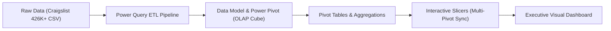

# 🚗 Used Car Market Analysis Dashboard (Excel BI & Analytics)

[](https://www.microsoft.com/en-us/microsoft-365/excel)
[](https://powerbi.microsoft.com/)
[](https://support.microsoft.com/en-us/office/power-pivot-overview-and-learning-f01ee37e-61e8-466d-888e-4a64d1f23696)
[]()
[](https://www.kaggle.com/)

---

## 📌 Executive Overview

The secondary automotive market is highly volatile, fragmented, and influenced by a multifaceted web of vehicle age, brand prestige, transmission preference, fuel type, mechanical condition, and regional supply-demand economics.

This project delivers an **end-to-end Business Intelligence (BI) and Market Analytics Dashboard** built in **Microsoft Excel**, powered by **Power Query** and the **Excel Data Model (Power Pivot OLAP engine)**. Processing over **426,000+ raw records** down to **362,880 clean listings** across **41 automakers** and **400+ US metropolitan regions**, this dashboard evaluates an estimated active vehicle inventory worth **$24.85 Billion USD**.

It empowers automotive dealerships, fleet managers, pricing analysts, and individual car buyers with interactive, granular visibility into inventory volume, price trends, condition valuations, and geographic hotspots.

---

## 📊 Key Business Metrics & Highlights

| Metric | Value | Business Interpretation |
| :--- | :--- | :--- |
| **Analyzed Vehicle Listings** | **362,880** | Robust sample representing active national used car supply |
| **Total Inventory Valuation** | **~$24.85 Billion USD** | Cumulative listing gross value across all analyzed inventory |
| **Tracked Manufacturers** | **41 Brands** | Comprehensive coverage from domestic workhorses to luxury exotics |
| **Analyzed US Regions** | **400+ Metro Areas** | Granular regional granularity across nationwide Craigslist markets |
| **Average Listing Price** | **$68,482 USD** | Skewed by commercial fleets, heavy-duty utility trucks & exotics |
| **Dominant Fuel Type** | **Gasoline (84.6%)** | 307,047 vehicles; EV/Hybrid adoption remains under 2% of listings |
| **Dominant Transmission** | **Automatic (78.3%)** | 284,179 vehicles; manual gearboxes represent just 5.5% |

---

## 🖥️ Dashboard Architecture & Visual Design

The dashboard is structured as an **Executive Command Center**, featuring dynamic KPI scorecards, interactive slicers, and multi-dimensional Pivot Charts synchronized via the Excel Data Model:

```
+--------------------------------------------------------------------------------------------------------------------------+
|                                           USED CAR SALES ANALYSIS DASHBOARD                                              |
+--------------------+-----------------------------------------------------------------------------------------------------+
| [Header Card]      |  [CHART 7: TOP MANUFACTURER INVENTORY VOLUME (HORIZONTAL BAR)]                                      |
| Used Car Sales     |  Ford (62K) | Chevrolet (48K) | Toyota (30K) | Honda (19K) | Jeep (16K) | Nissan (16K) ... (41 Brands)|
| Analysis           +----------------------------------+----------------------------------+-------------------------------+
+--------------------+  [CHART 1: PRICE BY CONDITION]   |  [CHART 2: TOP 10 REGIONS]       |  [CHART 3: TOP RESALE VALUE]  |
| [KPI CARD 1]       |  - Fair: $5.14B                  |  1. Columbus (3,123)             |  1. Volvo                     |
| Total Companies    |  - Excellent: $5.09B             |  2. Grand Rapids (2,833)         |  2. Toyota                    |
| 41                 |  - Good: $3.52B                  |  3. Jacksonville (2,761)         |  3. Ferrari                   |
+--------------------+  - Like New: $745M               |  4. Kansas City (2,746)          |  4. Aston-Martin              |
| [KPI CARD 2]       |  - New: $27.7M                   |  5. Detroit Metro (2,731)        |  5. Buick                     |
| Total Cars         |  - Salvage: $1.99M               |  6. Sarasota-Bradenton (2,726)   |  6. Ford                      |
| 362,880            +----------------------------------+----------------------------------+-------------------------------+
+--------------------+  [CHART 6: TRANSMISSION SHARE]   |  [CHART 5: FUEL TYPE VOLUME]     |  [CHART 4: AVG PRICE BY FUEL] |
| [INTERACTIVE SLICER|  3D Pie Chart:                   |  Doughnut Chart:                 |  3D Pie Chart:                |
| Fuel Type Filter]  |  - Automatic: 78.3% (284K)       |  - Gas: 307,047 (84.6%)          |  - Diesel: $152,402           |
| - Gas              |  - Other: 16.2% (58.7K)          |  - Other: 26,155 (7.2%)          |  - Other: $75,072             |
| - Diesel           |  - Manual: 5.5% (20.0K)          |  - Diesel: 21,511 (5.9%)         |  - Gas: $63,367               |
| - Hybrid           |                                  |  - Hybrid: 4,758 (1.3%)          |  - Electric: $26,699          |
| - Electric         |                                  |  - Electric: 1,510 (0.4%)        |  - Hybrid: $15,536            |
+--------------------+----------------------------------+----------------------------------+-------------------------------+
```

---

## 🔍 Deep-Dive Analytical Findings

### 1. Market Volume & Automaker Dominance
* **American Domestic Titans Lead Volume:** **Ford** leads the market with **62,325 vehicles (17.2%)**, followed by **Chevrolet** with **48,596 vehicles (13.4%)**. Together, they capture over **30% of total national inventory**, driven by pickups (F-Series, Silverado) and fleet trucks.
* **Japanese Dependability Champions:** **Toyota** (30,379 units / 8.4%) and **Honda** (19,247 units / 5.3%) represent the strongest import inventory shares, highlighting strong consumer retention and aftermarket supply.
* **Specialty & Luxury Segment:** Brands like **Porsche** (1,231 units), **Tesla** (816 units), **Ferrari** (62 units), and **Aston-Martin** (21 units) show tight supply and highly defensive pricing dynamics.

### 2. Transmission & Powertrain Transitions
* **Automatic Hegemony:** **78.3% (284,179 units)** of all used vehicles feature automatic transmissions. Manual transmissions have dwindled to an enthusiast niche of just **5.5% (20,011 units)**.
* **Internal Combustion Still Rules:** Gasoline vehicles constitute **84.6% (307,047 listings)** of the secondary market.
* **Alternative Powertrains in Infancy:** Despite new-car EV buzz, used electric vehicles account for only **1,510 listings (0.4%)**, while Hybrids account for **4,758 listings (1.3%)**.

### 3. Valuation & Resale Price Dynamics
* **Diesel Fleet Premium:** Diesel-powered vehicles command the highest average reselling price (**$152,402**), skewed upward by heavy-duty commercial utility trucks (F-250/F-350, RAM 2500/3500, Duramax) and specialized machinery.
* **Electric & Hybrid Pricing:** Electric vehicles average **$26,699**, while hybrid models average **$15,536**, offering accessible price points for fuel-conscious buyers.
* **Condition Capital Allocation:** Over **$10.23 Billion** of inventory value is tied up in "Fair" and "Excellent" condition vehicles combined ($5.14B and $5.09B respectively). Salvage vehicles total under $2M in value.

### 4. Regional Automotive Epicenters
* The top 10 regions by active inventory listings are:
  1. **Columbus, OH:** 3,123 listings
  2. **Grand Rapids, MI:** 2,833 listings
  3. **Jacksonville, FL:** 2,761 listings
  4. **Kansas City, MO:** 2,746 listings
  5. **Detroit Metro, MI:** 2,731 listings
  6. **Sarasota-Bradenton, FL:** 2,726 listings
  7. **Nashville, TN:** 2,703 listings
  8. **Milwaukee, WI:** 2,692 listings
  9. **New Hampshire:** 2,689 listings
  10. **Central NJ:** 2,684 listings
* The Midwest and Southeast display the highest liquidity and transaction density for used vehicle sales.

---

## 🛠️ Data Pipeline & Engineering Workflow



1. **Extraction (ETL):** Ingested large-scale tabular data (426,880 listings, 1.4 GB raw) via Excel's **Power Query** engine.
2. **Data Cleaning & Transformation:**
   * Removed corrupt records, extreme anomalies, and missing values.
   * Standardized categorical variables (`fuel`, `transmission`, `condition`, `manufacturer`, `region`).
   * Cleaned numeric columns (`price`, `odometer`, `year`).
   * Formatted currency and unit conventions.
3. **Data Modeling (Power Pivot):**
   * Loaded cleaned table (362,880 rows) directly into the **Excel Data Model (xVelocity / VertiPaq in-memory engine)** to bypass the standard 1,048,576 Excel worksheet row limitation and ensure blazing-fast query execution.
4. **Analysis & Dynamic Calculations:**
   * Generated interconnected **Pivot Tables** aggregating volume, averages, and sums across 41 manufacturers and 400+ regions.
5. **UI/UX & Visualization Design:**
   * Formatted unified dashboard canvas with customized rounded cards, vector SVG iconography, clear hierarchy, and an interactive **Fuel Type Slicer** controlling multiple visualizations concurrently.

---

## 📂 Repository File Structure

```text
├── assets/
│   ├── archive_8.zip                 # Compressed source dataset archive
│   └── vehicles.csv                  # Raw dataset (426K+ records; gitignored due to 1.4GB size)
├── Used Car Sales Analysis.xlsx       # Core Excel Workbook (Data Model, Power Query, Dashboard)
├── .gitignore                        # Git ignore rules for large data files and caches
└── README.md                         # Comprehensive project documentation
```

---

## 🚀 How to Open & Explore the Dashboard

1. **Prerequisites:**
   * Microsoft Excel 2016, 2019, 2021, or Microsoft 365 (desktop version recommended for Power Pivot support).
2. **Clone the Repository:**
   ```bash
   git clone https://github.com/your-username/used-car-market-analysis-dashboard.git
   cd used-car-market-analysis-dashboard
   ```
3. **Open the Workbook:**
   * Launch `Used Car Sales Analysis.xlsx`.
   * Switch to the **Dashboard** tab for the interactive visual command center.
   * Switch to the **Sheet1** tab to explore the underlying Pivot Tables and calculations.
4. **Interact with the Visuals:**
   * Click on any button in the **Fuel Type** slicer (e.g., *Gas*, *Diesel*, *Electric*, *Hybrid*) to dynamically filter all linked charts in real time.

---

## 💡 Strategic Business Recommendations

1. **Dealership Inventory Sourcing:** Focus inventory acquisition on **Ford, Chevrolet, and Toyota**, which account for nearly 40% of secondary market demand and boast superior resale liquidity.
2. **Fuel Transition Strategy:** While EVs are rapidly adopted in new car sales, their secondary market footprint is still minuscule (<0.5%). Dealerships should maintain a balanced gasoline-heavy fleet while piloting EV trade-in programs in top metropolitan areas.
3. **Regional Arbitrage:** Discrepancies in regional supply (e.g., high inventory density in Columbus and Grand Rapids vs. coastal areas) create opportunities for automated vehicle transport and regional pricing arbitrage.

---

## 👨‍💻 Author & Connect

* **Project Creator:** Shaqran Hussain
* **Role:** Data Analyst / BI Developer
* **LinkedIn:** [Shaqran Hussain](https://www.linkedin.com/)
* **Portfolio / GitHub:** [GitHub Profile](https://github.com/)

---

*⭐ If you find this project insightful or useful for your own BI workflows, please consider giving this repository a star!*
